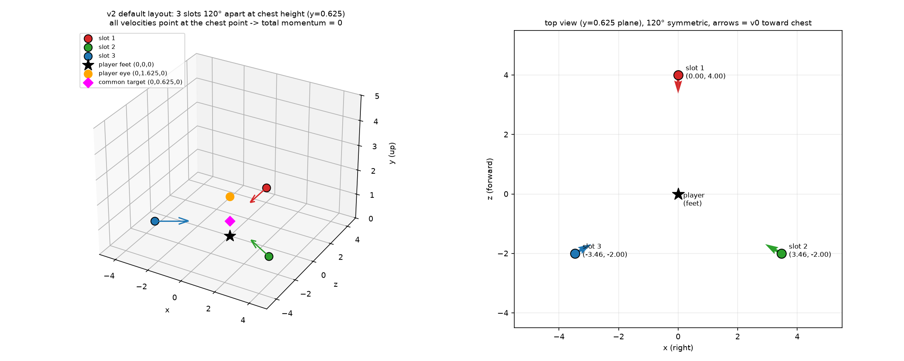
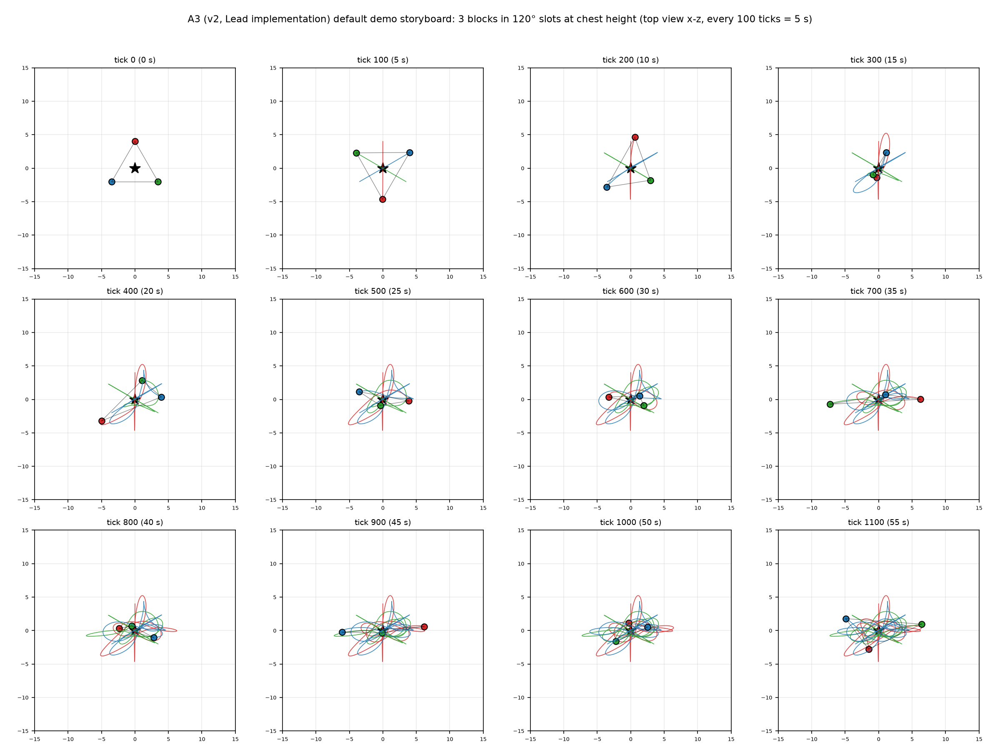

# Threebody 三体引力模拟数据包

> Minecraft Java 数据包（多版本支持）：**1.20.1 / 1.21.1 / 1.21.3 / 1.21.11 / 26.3 / 26.4-pre-1**
> 用方块展示实体在游戏里模拟三体（n 体）无序运动。
>
> 版本：**v2.2.0**

- 进游戏无任何变化，只有手动执行指令才会出现实体
- 一条指令生成 1 个方块展示实体（默认黑色混凝土，初始速度朝玩家胸口）
- 实时模拟这些展示实体之间的**相互牛顿引力**（Plummer 软化，无碰撞、不破坏地形、不影响其它实体）
- 默认前 3 个生成位置 120° 对称、**总动量为零** → 三体在你身边混沌缠斗，不会整体漂走
- 支持 **16 种混凝土颜色**快捷指令，并按需配置质量 / 速度
- 物理常数、软化半径、默认质量/速度都可以用指令调整




更多预览（单/双/三体 3D 轨迹、距离曲线、定点实现无漂移验证）在 [docs/preview](docs/preview)。

---

## 支持的 Minecraft 版本（下载哪个包）

各版本的差异只在数据包元数据（pack_format）和个别实体/命令格式，玩法/物理参数完全一致。请下载与你游戏版本对应的 zip：

| Minecraft 版本 | 文件（`dist/`） | 数据包格式 | 备注 |
|---|---|---|---|
| 1.20.1 | `threebody-1.20.1.zip` | `pack_format: 15` | 旧目录结构；**没有宏函数**，自定义参数改用 storage 预设接口（见下文 / [docs/README-1.20.1.md](docs/README-1.20.1.md)） |
| 1.21.1 | `threebody-1.21.1.zip` | `pack_format: 48` | |
| 1.21.3 | `threebody-1.21.3.zip` | `pack_format: 57` | |
| 1.21.11 | `threebody-1.21.11.zip` | `min_format/max_format: 94` | 代码与 1.21.3 相同 |
| 26.3 | `threebody-26.3.zip` | `min_format/max_format: 121` | 展示实体 `block_state` 新格式，已单独构建 |
| 26.4-pre-1 | `threebody-26.4-pre-1.zip` | `min_format/max_format: 128` | 同上（快照版） |

> 也可以在 GitHub **Releases** 页面按版本下载（`v2.2.0`）。`dist/SHA256SUMS.txt` 是各 zip 的校验和。
> 其它 1.21.x/26.x 中间版本（如 1.21.4–1.21.10、26.1/26.2）未逐一测试，通常可用对应世代的构建（1.21.1–1.21.11 一份、26.3+ 一份），但请自行验证。

### 1.20.1 的接口差异（重要）

1.20.1 没有宏函数（`/function ns:f {args}` 是 1.20.2+ 才有），因此 `add_custom` / `add_<color>_custom` / `config` 改成**两步 storage 预设**：

```mcfunction
# 1.20.1：先 merge 参数，再调用函数
data merge storage threebody:in {mass:3,speed:0.05}
function threebody:add_red_custom

# 清空预设参数（恢复默认）
function threebody:params/reset
```

`add` / `add_<颜色>`（16 色）/ `stop` / `resume` / `clear` / `help` 在 1.20.1 与新版用法一致。详细说明见 [docs/README-1.20.1.md](docs/README-1.20.1.md)。

---

## 安装

> 需要 Minecraft Java（按上表选对应版本）。**同一个世界只能启用一个版本的 threebody 包**。

**方式 A：加进已有存档（推荐）**

1. 解压或直接使用仓库里与你版本对应的 `dist/threebody-<版本>.zip`；
2. 放进存档的 `datapacks` 文件夹：
   - Windows：`%APPDATA%\.minecraft\saves\<存档名>\datapacks\`
   - 本机示例：`F:\MC-environment\.minecraft\versions\1.21.3-Fabric\saves\<存档名>\datapacks\`
3. 进游戏后执行 `/reload`（或退出重进世界）。

**方式 B：新建世界时启用**：把对应的 zip 放进游戏目录的 `datapacks` 文件夹（没有就新建），创建新世界 → 更多 → 数据包 → 启用；也可以直接把 zip 拖进那个界面。

**方式 C：服务器**：把 zip 放进 `<服务器目录>/world/datapacks/`，控制台执行 `/reload`。

加载成功后进游戏没有任何可见变化（只登记计分板 + 一个每 tick 检查"是否启动"的空转判断）。

---

## 快速开始

```
/function threebody:add          ← 生成 1 个黑色方块（在眼前约 4 格、胸口高度），默认静止悬空
/function threebody:add_red      ← 再加一个红色
/function threebody:add_blue     ← 再加一个蓝色 → 三个方块开始互相引力塌缩、混沌缠斗
```

- **默认初始速度为 0（静止）**：所有方块生成后先悬空静止；总动量为零，所以无论加多少个，整个系统都不会漂走。单个方块时没有引力对象，会一直静止悬空。
- 默认前 3 个槽位是 120° 对称的（第 1 个正前方，第 2、3 个斜后方左右各 120°）。加满 3 个后它们会互相吸引、约 1 秒内塌缩到玩家身边，然后混沌缠斗；定点仿真 6000 tick（5 分钟）内最大离玩家约 9 格、系统中心不移动。
- 想让方块**朝你飞来**：给个初始速度，例如 `threebody:add_red_custom {args:{speed:0.046875}}`（约 4.3 秒飞到），或用 `vel` 指定方向；也可以 `threebody:config {args:{speed:0.046875}}` 改默认值（注意非零默认速度可能让系统整体缓慢漂移）。
- 三体运动对初值极敏感：只把某个方块挪 1/64 格，约 12 秒后轨迹就完全分叉——每次启动画面都不同，这就是"三体无序"。
- 建议执行时**平视前方**（默认槽位相对视线方向摆放，低头/抬头时这个 120° 环会跟着倾斜，功能不受影响）。

其它：

```
/function threebody:stop     暂停（实体冻结保留）
/function threebody:resume   继续模拟（不生成新实体）
/function threebody:clear    删除所有模拟实体并重置
/function threebody:config {args:{g:0.0625,soft:1.5,speed:0.0,mass:1}}   调整物理参数（speed=0 即默认静止）
/function threebody:help     游戏内中文帮助
```

---

## 指令总表

| 指令 | 作用 |
|---|---|
| `threebody:add` | 生成 1 个黑色混凝土方块（默认位置/质量，初始速度 0=静止）并开始模拟 |
| `threebody:add_white` … `threebody:add_black` | 生成指定颜色混凝土方块（共 16 种，见下） |
| `threebody:add_custom {args:{...}}` | 完全自定义生成 1 个（位置/初速/质量/方块） |
| `threebody:add_<color>_custom {args:{...}}` | 指定颜色 + 自定义质量/速度/位置/初速 |
| `threebody:stop` / `threebody:resume` | 暂停 / 继续模拟 |
| `threebody:clear` | 删除所有模拟实体并重置状态 |
| `threebody:config {args:{...}}` | 修改物理参数（保存在世界里） |
| `threebody:help` | 游戏内中文帮助 |

16 种颜色：`white`、`orange`、`magenta`、`light_blue`、`yellow`、`lime`、`pink`、`gray`、`light_gray`、`cyan`、`purple`、`blue`、`brown`、`green`、`red`、`black`。

```
/function threebody:add_white
/function threebody:add_orange
/function threebody:add_magenta
/function threebody:add_light_blue
/function threebody:add_yellow
/function threebody:add_lime
/function threebody:add_pink
/function threebody:add_gray
/function threebody:add_light_gray
/function threebody:add_cyan
/function threebody:add_purple
/function threebody:add_blue
/function threebody:add_brown
/function threebody:add_green
/function threebody:add_red
/function threebody:add_black
```

---

## 参数（`args`）

`add_custom` 和 `add_<color>_custom` 的参数都放在 `args` 里，**每一项都可以省略**（省略就用默认值）：

| 键 | 类型 | 说明 | 默认 |
|---|---|---|---|
| `pos` | `[x,y,z]` | 绝对坐标。与 `offset` 二选一，`pos` 优先 | 默认槽位 |
| `offset` | `[dx,dy,dz]` | 相对玩家脚底的偏移 | — |
| `vel` | `[vx,vy,vz]` | 绝对初速度（格/tick） | `0`（静止）；若给了 `speed` 则朝玩家胸口 |
| `speed` | 数字 | 只改速率，方向朝玩家胸口（`vel` 存在时忽略）；0 = 静止 | `0` |
| `mass` | 整数 | 质量，建议 1~1000 | 1 |
| `block` | 字符串 | 方块 id（`add_custom` 可用，颜色快捷指令会强制覆盖为对应颜色） | `minecraft:black_concrete` |

示例（复制即用）：

```
# 红色方块，质量 3，朝玩家速率 0.05
/function threebody:add_red_custom {args:{mass:3,speed:0.05}}

# 完全自定义：绝对坐标 + 初速度 + 质量 + 方块
/function threebody:add_custom {args:{pos:[100.5,82.0,200.5], vel:[0.0,0.05,0.0], mass:2, block:"minecraft:glowstone"}}

# 相对玩家脚底偏移 3 格、指定质量/速度
/function threebody:add_custom {args:{offset:[3.0,0.0,8.0], mass:2, speed:0.08}}
```

说明：`args` 这一层是必须的（Minecraft 宏函数的限制：一个复合标签里可以只写想改的键，直接写多个键则必须全给）。不写 `args:{...}` 会报错。

---

## 物理参数与调参

默认参数（为"数字方便 + 默认演示不出可见范围"选的）：

| 参数 | 默认值 | 说明 |
|---|---|---|
| `g` | `0.0625`（1/16） | 引力常数，单位 格³/(质量·tick²)。可调 0~0.5 |
| `soft` | `1.5` | 软化半径 ε（格），防止近距离数值爆炸/被弹飞 |
| `mass` | `1` | 默认质量（整数，建议 ≤1000） |
| `speed` | `0`（静止） | 默认初始速度（格/tick）；设 >0 时方向朝玩家胸口；旧版默认是 0.046875（3/64） |

```
/function threebody:config {args:{g:0.125}}          # 只改引力常数（可以只写想改的键）
/function threebody:config {args:{g:0.0625,soft:1.5,speed:0.0,mass:1}}   # 恢复默认
```

调参建议：

- **想让默认方块朝你飞**：把 `speed` 设为 0.046875（3/64）或其它值；注意任何非零初速都会给系统一个总动量（除非自己配对称初速），可能整体缓慢漂移。
- **运动更快/更热闹**：增大 `g`（如 0.125、0.25），或增大质量（质量线性放大加速度）。
- **更稳/更慢**：减小 `g` 或减小初始速度。
- **软化半径不要低于 1.0**：默认三体布局是在同一高度平面上向同一点塌缩，ε 太小会在近距离被弹飞出可见范围（ε=1.0 时 60 秒就可能到 50 格，1.5 才稳）。
- **定点精度边界**：默认 `g=0.0625,m=1` 时距离超过约 256 格引力会被整数截断为 0；单轴超过 312 格的实体对直接不计引力。默认参数适合 **2~40 格**尺度。
- **大尺度（100~300 格）**：把 `g` 调到 0.1~0.5 或把质量调大（约 4~16），同时注意 312 格的上限。换算关系：保持观感不变时，尺度放大 S 倍需要质量 ×S 或 G ×S，初速度不变（周期 ×S^1.5）。

---

## 进阶玩法示例

**双体（二体问题）**：对称初速度，两个等质量方块互绕/振荡。

```
/function threebody:clear
/function threebody:add_custom {args:{offset:[4.0,0.625,0.0], vel:[0.0,0.0,0.05], mass:1}}
/function threebody:add_custom {args:{offset:[-4.0,0.625,0.0], vel:[0.0,0.0,-0.05], mass:1}}
```

**更大范围的三体（半径 6 格，120° 对称，仍然不漂）**：默认槽位半径 4 格比较贴脸，想拉开范围就手动摆一个半径 6 格的对称三角形（速度默认朝玩家胸口）：

```
/function threebody:clear
/function threebody:add_custom {args:{offset:[0.0,0.625,6.0]}}
/function threebody:add_custom {args:{offset:[5.196,0.625,-3.0]}}
/function threebody:add_custom {args:{offset:[-5.196,0.625,-3.0]}}
```

**三体 figure-8（8 字舞周期解，彩蛋）**：把引力调到 g=0.25、软化 0.5，三个质量 4 的方块按下面初始条件摆放，能看出三个方块互相追逐画出 8 字（受定点量化/软化影响只能维持 2~3 圈，属正常）：

```
/function threebody:clear
/function threebody:config {args:{g:0.25, soft:0.5}}
/function threebody:add_custom {args:{offset:[11.64,-2.917,0.0], vel:[0.13458,0.12481,0.0], mass:4, block:"minecraft:red_concrete"}}
/function threebody:add_custom {args:{offset:[-11.64,2.917,0.0], vel:[0.13458,0.12481,0.0], mass:4, block:"minecraft:lime_concrete"}}
/function threebody:add_custom {args:{offset:[0.0,0.0,0.0], vel:[-0.26916,-0.24962,0.0], mass:4, block:"minecraft:blue_concrete"}}
```

玩完记得恢复默认：`/function threebody:config {args:{g:0.0625,soft:1.5}}`。

> 以上坐标是相对玩家脚底的偏移，建议在空旷高处或虚空世界实验；先 `/tp` 定好位置再执行。

---

## 性能

每 tick 计算所有实体对（O(N²)），官方 1.21.3 服务端 `/tick sprint` 实测：

| 实体数 | 物理耗时 |
|---|---|
| 3 | 约 0.2 ms/tick（有玩家在线时整服约 1~2 ms/tick） |
| 5 | 约 0.3 ms/tick |
| 10 | 约 1.0~1.4 ms/tick（首次 sprint 偶见预热抖动） |

20 TPS 的预算是 50 ms/tick，10 个实体以内余量很大。客户端帧率影响另算。

---

## 常见问题

**Q：执行 `threebody:add` 没反应？**
- 确认是**游戏内玩家**执行（`add` 需要玩家位置；服务器控制台执行不会生成）；数据包已启用：`/datapack list`。
- 已经是暂停状态？`add` 会自动继续。想继续但不想加实体：`threebody:resume`。

**Q：执行 `add` 之后方块不动？**
默认初始速度是 0，方块生成后就是静止悬空的；只加 1 个时没有其它引力对象，它会一直不动。再 `add` 第 2、3 个后就开始互相吸引运动。想让它们立刻朝你飞，用 `speed` 或 `vel` 参数，例如 `/function threebody:add_custom {args:{speed:0.046875}}`。

**Q：为什么默认第 2、3 个方块从斜后方出现？**
为了让前三个方块总动量为零、整团不漂走，默认槽位按 120° 对称布置（正前 + 两个斜后方）。默认速度是 0，加满 3 个后它们会朝彼此塌缩、从你身边穿过并缠斗，所以背面出现是正常现象。想换布局用 `add_custom`。

**Q：实体飞远后不动了？**
Minecraft 只加载玩家附近的区块，飞远的实体在未加载区块里会被冻结（不是 bug）。靠近会恢复；或用 `/kill @e[type=minecraft:block_display,tag=threebody_body]` 清掉。

**Q：`clear` 之后怎么还有方块？**
`kill` 只作用于已加载区块里的实体。飞远的方块在未加载区块里选不到，等玩家靠近会重新出现；要彻底清掉需要先靠近/forceload 对应区块再 clear。

**Q：能换成别的方块（非混凝土）吗？**
可以，`add_custom` 的 `block` 参数支持任意普通完整方块 id（如 `minecraft:glowstone`、`minecraft:glass`）。带方块状态（楼梯朝向等）不支持。

**Q：能用在别的版本吗？**
`pack_format=57` 对应 1.21.2 / 1.21.3。1.21.4+ 的数据包格式和展示实体/命令有差异，不保证能用。

---

## 从源码构建

仓库支持**多版本构建**：源码只有一份，`build.py` 按 `versions.json` 生成各版本 zip（自动处理 pack.mcmeta 格式、1.20.1 的复数目录、26.3+ 的展示实体 block_state 新格式等）。

```bash
python3 build.py                    # 构建全部版本 -> dist/
python3 build.py --only 1.21.3      # 只构建一个版本
python3 build.py --list             # 列出可构建版本
```

- 需要 **Python 3**（Windows 可用 `python build.py`）。`build.sh` / `build.ps1` 是包装脚本。
- 构建产物：`dist/threebody-<版本>.zip` + `dist/SHA256SUMS.txt`（zip 内固定时间戳，便于校验）。
- `compat/1.20.1/` 是 1.20.1 专用源码（复数目录 + 无宏的两步 storage API）。
- `overrides/<版本>/` 是某版本的少量文件覆盖（目前 26.3/26.4-pre-1 需要改两处 `block_state` 格式）。

注意：`.mcfunction` 里普通命令行首不要写 `$`（`$` 行是宏，必须包含 `$(...)`）；提前退出函数要写 `return 0`（1.20.1 也支持；但 1.20.1 源码里用嵌套 execute 拆分子函数实现，不依赖 return）。

---

## 目录结构

```
threebody/                    ← git 仓库根
├─ pack.mcmeta                ← 默认（1.21.3）源码的元数据，构建时按版本重写
├─ data/threebody/function/   ← 现代版本（1.21.1–26.4）源码：54 个函数
├─ compat/1.20.1/             ← 1.20.1 专用源码（复数目录、storage 预设 API）
├─ overrides/                 ← 个别版本的少量文件覆盖（26.3/26.4-pre-1 的 block_state）
├─ versions.json              ← 版本 → pack 元数据/源码/布局 的构建矩阵
├─ build.py / build.sh / build.ps1
├─ dist/                      ← 各版本 zip + SHA256SUMS
├─ docs/preview/              ← 物理轨迹预览图
├─ docs/README-1.20.1.md      ← 1.20.1 版专用说明
├─ README.md
├─ 技术说明.md                 ← 实现原理、定点数学、多版本构建、验证记录
└─ CHANGELOG.md
```

实现细节（定点数学、引力公式、验证记录、性能）见 [技术说明.md](技术说明.md)。

## 版本历史

见 [CHANGELOG.md](CHANGELOG.md)。

## 相关项目

- 本仓库（三体引力数据包）：[MJIFmc/threebody-mc-datapack](https://github.com/MJIFmc/threebody-mc-datapack)
- Worldgen 数据包（超高虚空世界预设，单独仓库）：[MJIFmc/mc-bigvoid-datapack](https://github.com/MJIFmc/mc-bigvoid-datapack)

## License

本项目采用 **MIT License**，见 [LICENSE](LICENSE)（Copyright (c) 2026 MJIFmc）。
